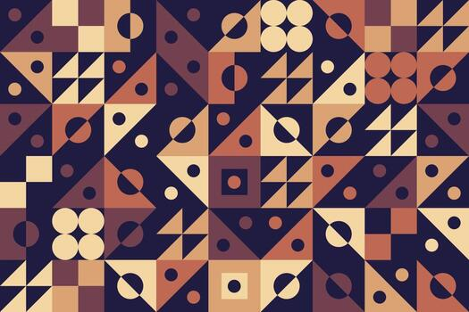

# Figuras_geometricas_Alexandra

# Figuras geométricas

Aplicación web en PHP que calcula el **área** y el **perímetro** de un triángulo, un rectángulo, un cuadrado o un círculo, usando programación orientada a objetos, sesiones, validaciones y estilos CSS.

<!-- Imagen de portada: guarda una captura en img/portada.png -->

---

## Cómo funciona

### Lados que pide cada figura

| Figura | Campos | Fórmula del área | Fórmula del perímetro |
|---|---|---|---|
| Cuadrado | 1 (lado) | lado × lado | lado × 4 |
| Rectángulo | 2 (base y altura) | base × altura | 2 × base + 2 × altura |
| Círculo | 1 (radio) | π × radio × radio | 2 × π × radio |
| Triángulo | 3 (lados) | fórmula de Herón | suma de los tres lados |

---

## Programación orientada a objetos

- **`FiguraGeometrica`** es la clase padre. Guarda `tipoFigura` y `lado1` como atributos privados, con constructor, destructor, getters y setters.
- **`Cuadrado`, `Rectangulo`, `Circulo` y `Triangulo`** heredan de ella con `extends`.
  - `Rectangulo` añade `lado2`, y `Triangulo` añade `lado2` y `lado3`.
  - En `Circulo`, `lado1` hace de radio.
- Cada clase hija tiene su propio constructor (que llama a `parent::__construct`), su destructor, `calcularArea()`, `calcularPerimetro()` y `__toString()`.
- Los atributos solo se leen desde las clases hijas mediante los getters.
- `__toString()` devuelve la descripción de la figura, y es lo que se escribe en `resultado.php` con un simple `echo`.

---

## Sesiones

Se usa `$_SESSION` para conservar los datos entre pantallas:

- `figura`: la figura elegida.
- `lado1`, `lado2`, `lado3`: los lados introducidos.
- `ladosValidos`: indica si `validar.php` dio por buenos los lados.
- `errorLados`: mensaje de error que se muestra una sola vez en `lados.php`.

Si el usuario vuelve atrás, el desplegable recuerda la figura y los campos recuperan los lados escritos.

---
